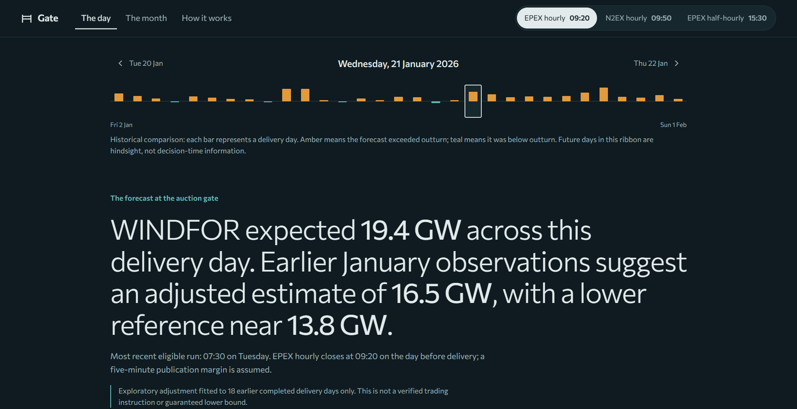

# Gate - Day-ahead wind, as known at the auction

Gate is a pilot for a Great Britain electricity utility's day-ahead procurement team. It reconstructs the national wind forecast available before selected wholesale auction deadlines, compares it with subsequently reported wind generation, and measures the uncertainty relevant to procurement planning.

**Pilot scope:** purchase decisions made **1–31 January 2026**, for electricity delivery **2 January–1 February 2026**.

**[Live application](https://r7k4m2q.vercel.app/)** · **[Source code](https://github.com/ashh-droid/r7k4m2q)** · **[Interactive API documentation](https://r7k4m2q.vercel.app/api/docs)**

**Video demonstration:** [ Unlisted YouTube link to be added before submission.](https://youtu.be/sP-w30T-zRY)



*The day view: published wind forecast, an exploratory historical adjustment, and a lower reference, with actual generation available for retrospective comparison.*

## The product

- **The day:** Browse delivery days and compare what WINDFOR had published before EPEX hourly (09:20), N2EX hourly (09:50), or EPEX half-hourly (15:30). Inspect the hourly forecast, a clearly labelled exploratory adjustment, and an interval informed by previous days. Reveal the eventual generation separately. The revision history identifies which updates arrived after the decision cutoff. Export the selected day as CSV.
- **The month:** Explore how the forecast-to-actual difference varies with wind level, hour and forecast horizon. Compare published forecasts with an adjustment evaluated chronologically on later January days.
- **How it works:** Review the forecast-selection rule, auction-time assumptions, data alignment, validation method and limitations.

Only Elexon's **FUELHH (WIND)** and **WINDFOR** datasets are used; no demand, market-price or external weather data is included.

## Key findings

The January snapshot contains **1,488 half-hourly actual values**, **744 native hourly forecast targets**, and **17,864 retained forecast publication/target records**. For the **EPEX hourly 09:20** scenario:

| Measure | Result |
| --- | ---: |
| Native hourly target comparisons | 744 |
| Mean signed difference (forecast − actual) | +1,746 MW |
| Hours with forecast above observed generation | 85% |
| Published forecast mean absolute difference (full cohort) | 2,022 MW |
| Walk-forward evaluation set | 552 hours across 23 days |
| Published forecast MAE on evaluation set | 2,123 MW |
| Wind-band adjusted MAE on same set | 1,382 MW |
| Observed coverage of lower reference | 85.5% (below the 90% target) |

The observed gap increases with forecast wind level: roughly **+0.7 GW** for forecasts below 10 GW, versus **+2.5 GW** above 14 GW. The difference could partly reflect curtailment or different wind-generation populations in the two sources. These datasets alone cannot establish the cause.

For **21 January 2026**, the published EPEX-hourly forecast averaged approximately **19.4 GW**. An experimental adjustment trained on **18 earlier completed delivery days** yielded approximately **16.5 GW**, with a lower historical reference near **13.8 GW**. These figures describe a historical pilot, not a recommended trading position.

## Methodology

**Sources and resolution:** [Elexon FUELHH](https://bmrs.elexon.co.uk/api-documentation/endpoint/datasets/FUELHH/stream) supplies half-hourly wind actuals (`fuelType=WIND`); [WINDFOR](https://bmrs.elexon.co.uk/api-documentation/endpoint/datasets/WINDFOR/stream) supplies forecasts with hourly targets and multiple `publishTime` values. Forecasts are compared with the actual observation for the half-hour beginning on the hour. Missing values remain missing; no `:30` forecasts are invented.

**Point-in-time forecast selection:** For each delivery target, Gate selects the most recent WINDFOR publication timestamp **no later than auction gate closure minus an assumed five-minute margin**. Later publications can be inspected in the revision history but never replace the forecast in the reconstructed decision. Timestamps are compared in UTC and displayed in `Europe/London`. The three auction timings are scenario settings, not a claim about any client's internal order deadline. The EPEX half-hourly setting does not change WINDFOR's hourly resolution.

**Error and energy:** Signed difference is `forecast MW − actual MW`; positive values mean the forecast exceeded reported generation. MAE measures absolute differences and RMSE puts more weight on large differences. Illustrative forecast energy in GWh assumes each hourly forecast MW value represents the hourly average; observed energy sums each half-hour MW value multiplied by 0.5 hours. This is not settlement-grade trading-volume analysis.

**Exploratory adjustment:** For delivery day D, Gate estimates average signed differences in three forecast-wind bands (`<10 GW`, `10–14 GW`, `>14 GW`) using only completed delivery days on or before **D−2**. It subtracts the relevant historical average from the published forecast and derives a 10th–90th percentile reference interval from previous residuals. It withholds the adjustment until at least seven earlier completed days are available. The walk-forward evaluation uses only prior days for each evaluated date, not a future-informed leave-one-day-out fit.

**Limits:** The January sample is short, and the 85.5% achieved lower-reference coverage does not justify a guarantee. The FUELHH and WINDFOR populations may differ. The historical snapshot retrieved in October 2026 may contain revised actuals unavailable during the original January decisions, so the adjusted estimate is not an exact reconstruction of an operational calibration system. No consumer demand, existing positions or power prices were provided; Gate cannot determine how much electricity to purchase.

## Run locally

**Recommended: Docker.** From the repository root, with Docker Desktop (Linux containers) or Docker Engine and Compose installed:

```bash
docker compose up --build
```

Open **http://localhost:3000**. FastAPI's interactive documentation is available at **http://localhost:3000/api/docs**. The January data snapshot is included, so starting the app does not require contacting Elexon.

**Without Docker:** use Python 3.12 and Node.js 22. Start the backend and frontend in separate terminals.

Windows PowerShell — backend:

```powershell
py -3.12 -m venv .venv
.\.venv\Scripts\python.exe -m pip install -r backend\requirements-ingest.txt
.\.venv\Scripts\python.exe -m uvicorn main:app --app-dir backend --reload --port 8000
```

macOS/Linux — backend:

```bash
python3.12 -m venv .venv
./.venv/bin/python -m pip install -r backend/requirements-ingest.txt
./.venv/bin/python -m uvicorn main:app --app-dir backend --reload --port 8000
```

Frontend (separate terminal):

```bash
cd frontend
npm ci
npm run dev
```

Open **http://localhost:5173**; Vite proxies API requests to the Python server. Run tests from the project root using the virtual-environment Python (`-m pytest -q`); run `npm run build` from `frontend/`. GitHub Actions runs backend tests and the frontend production build on pushes and pull requests.

## Project structure

| Path | Responsibility |
| --- | --- |
| `backend/app/analytics.py` | Timezone-aware parsing, as-of forecast selection and error statistics |
| `backend/app/planning.py` | Auction cutoffs, prior-only wind-band adjustment and walk-forward evaluation |
| `backend/app/main.py` | Read-only FastAPI endpoints |
| `backend/app/schemas.py` | Pydantic response contracts exposed through OpenAPI |
| `backend/app/store.py` | Loads and validates the historical CSV snapshot |
| `backend/scripts/ingest.py` | Downloads and processes Elexon source data |
| `backend/scripts/audit.py` | Audits completeness, native forecast resolution and alignment |
| `backend/data/processed/` | Included January snapshot and source metadata |
| `backend/tests/` | Backend unit and historical-data integration tests |
| `frontend/src/views/` | Day, month and methodology views |
| `frontend/src/components/` | Charts, headline, navigation, hourly strip and revision history |
| `frontend/src/styles/`, `frontend/DESIGN.md` | Editorial design system, responsive styles and design rationale |
| `notebooks/analysis.ipynb` | Reproducible January analysis |
| `docker-compose.yml`, `backend/Dockerfile`, `frontend/Dockerfile` | Reproducible local containers |
| `frontend/nginx.conf`, `vercel.json` | Application routing and public deployment |
| `.github/workflows/ci.yml` | Automated backend tests and frontend production build |

To recreate the snapshot, install the ingestion requirements and run `python backend/scripts/ingest.py` from the repository root. This fetches Elexon's public endpoints. The committed snapshot preserves the data used for the published figures.

## AI assistance

AI tools were used in this project as permitted by the assignment:

- **OpenAI ChatGPT:** requirements analysis, initial application implementation, debugging, tests, and technical-documentation drafts.
- **Anthropic Claude:** independent code and data review, exploration of wind-level patterns, UI design and frontend redevelopment, API improvements, tests, and README editing.

The implementation and numerical findings were reviewed through automated tests, source inspection, the included Elexon snapshot and local application checks. The historical data originates from **Elexon BMRS**.
